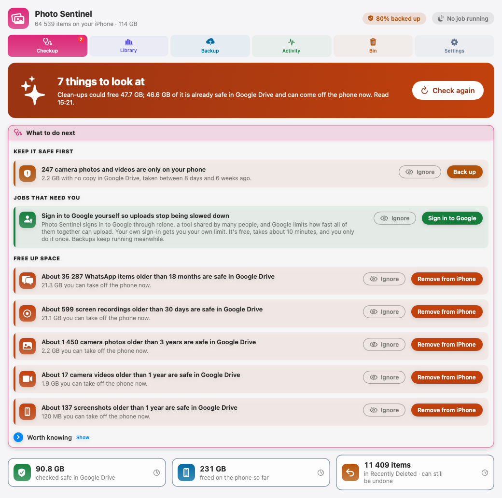

# Photo Sentinel

**by CloudScale**

> Open source iPhone image backup, cleanup, organization and safe offload for macOS.

[](LICENSE)


Photo Sentinel is a free, open source Mac app that backs up your iPhone photos and
videos to Google Drive, checks every copy, and only then helps you take them off
the phone. It shows what is filling your phone (by app, kind, year and place),
lets you set rules such as "keep WhatsApp for 18 months", and removes only what
it can prove is safe in Google Drive.

**The default is always to keep media on the iPhone.** Nothing is removed until
you type Confirm and click Delete in the dialog macOS shows.



---

## Status

**Beta, in daily use.** On the library it was built against it has freed 231 GB
(30,921 items) from the iPhone, with every removal checked against Google Drive
first. Latest release: [v0.6.0](https://github.com/andrewbakercloudscale/photo-sentinel/releases/latest).

| | |
|---|---|
| Mac app (`app/`) | Every operation runs from the app: Checkup, Library, Backup, Activity, Bin, Settings |
| Engine (`src/`) | The `iphone-image` command line tool the app runs. Usable on its own |
| Safety model | [`docs/SAFETY.md`](docs/SAFETY.md): read this first if you care about not losing photographs |
| Design | [`docs/SPEC.md`](docs/SPEC.md), [`docs/PLAN.md`](docs/PLAN.md), [`docs/MAC-APP-DESIGN.md`](docs/MAC-APP-DESIGN.md) |
| Picking it up mid-project | [`HANDOVER.md`](HANDOVER.md): measured numbers, decisions taken, and the mistakes that shaped them |

**Not done yet:**

- **Live Photos: built, not yet run on a real library.** Checkup's "Back up
  Live Photos" button copies each one's moving part to Google Drive beside its
  photo; after that, Live Photos can be cleaned up like any other photo.
- **A signed download.** For now you build the app yourself (below).
- **Google Drive only.** Other backup targets, such as Amazon S3, are planned.

**How it reads the phone:** through Apple's PhotoKit, against the Mac's Photos
library, not over USB. An early spike found USB reaches 1.9% of a real
94,180-item library and the phone refuses deletion outright
([`spikes/P0-transport.md`](spikes/P0-transport.md)). PhotoKit also records which
app saved each item, so "clean up WhatsApp" is exact rather than a filename guess.

---

## The Mac app

| Tab | What it does |
|---|---|
| **Checkup** | What to do next, in order: what is only on your phone, jobs that need you, and clean-ups already safe in Google Drive, each with a button |
| **Library** | What fills the phone, by app, kind, year and place. Set your backup rules and see what stays on the phone |
| **Backup** | Where backups go in Google Drive, what is not backed up yet, and a full check of Google Drive |
| **Activity** | Running and past jobs; a stopped job resumes with one click |
| **Bin** | Everything removed, with the evidence for each, and Recover to download it back from Google Drive |
| **Settings** | Google Drive account, your own Google sign-in, folders, and the optional Google Photos copy |

---

## Install

Paste this into Terminal. It installs what is missing (Xcode command line tools,
Homebrew, Python 3.14, exiftool, ffmpeg, rclone), clones this repo to
`~/Desktop/github/iphone-image-manager`, builds the app, installs it to
`~/Applications` and opens it. Paste it again to update.

```bash
cat > /tmp/install-photo-sentinel.sh <<'EOF'
#!/bin/bash
# Installs Photo Sentinel from https://github.com/andrewbakercloudscale/photo-sentinel
set -euo pipefail
DIR="$HOME/Desktop/github/iphone-image-manager"   # the app runs its engine from here
if ! xcode-select -p >/dev/null 2>&1; then
  xcode-select --install
  echo "Finish installing the command line tools in the window that opened, then paste this again."
  exit 1
fi
if ! command -v brew >/dev/null 2>&1; then
  /bin/bash -c "$(curl -fsSL https://raw.githubusercontent.com/Homebrew/install/HEAD/install.sh)"
  eval "$(/opt/homebrew/bin/brew shellenv 2>/dev/null || /usr/local/bin/brew shellenv)"
fi
brew install python@3.14 exiftool ffmpeg rclone
if [ -d "$DIR/.git" ]; then
  git -C "$DIR" pull --ff-only
else
  mkdir -p "$(dirname "$DIR")"
  git clone https://github.com/andrewbakercloudscale/photo-sentinel.git "$DIR"
fi
cd "$DIR"
"$(brew --prefix python@3.14)/bin/python3.14" -m venv .venv
.venv/bin/pip install --quiet -e .
(cd spikes/iimphotos && swift build -c release)
bash app/scripts/build-app.sh
echo "Photo Sentinel is installed in your Applications folder and open."
EOF
chmod +x /tmp/install-photo-sentinel.sh && exec /tmp/install-photo-sentinel.sh
```

Keep the folder where it is: the app runs the engine from there. The app is
signed for your Mac only; no Apple Developer account is involved. With Xcode
installed, the build runs the app's tests first; with only the command line
tools it skips them, because XCTest comes with Xcode.

Before the first run, set up Photos as described in
[Setup](#setup-point-photos-at-icloud-but-keep-the-originals-there) below, then
connect Google Drive in Settings and start from Checkup.

---

## How it works

```
Photos library (iCloud)
   │ scan          list everything, change nothing
   ▼
Ledger (SQLite)
   │ sync          fetch originals to the Mac in small batches, hashed
   ▼
Mac (a staging area, not a home)
   │ cloud         upload to Google Drive, then check Google Drive's hash
   ▼
Google Drive      the backup
   │ release       Mac copy goes to the Trash once Google Drive has it
   │ audit         re-read every hash in Google Drive, whenever you like
   ▼
                   NOTHING HAS BEEN REMOVED

   │ remove-from-iphone --apply    only when you say so
   ▼
Recently Deleted on the phone (30 days), then the space is back
```

Back up first, check second, remove only when you ask. The Mac never needs room
for the whole library: each batch leaves it once Google Drive has it.

### The engine on its own

The app runs these; you can too.

```bash
iphone-image doctor                 # check the Mac and say exactly what to change
iphone-image status                 # where everything stands
iphone-image scan                   # list the Photos library, change nothing
iphone-image list --source whatsapp --older-than 18m
iphone-image sync --source camera --budget 5GB --apply     # fetch a batch of originals
iphone-image cloud --apply          # upload to Google Drive and check it
iphone-image release --apply        # free the Mac once Google Drive has the files
iphone-image audit                  # re-read every hash in Google Drive
iphone-image remove-from-iphone --source screenshot --older-than 1y   # a plan, removes nothing
iphone-image recover --id <ledger id>   # download back from Google Drive, hash-checked
```

`doctor` is the one to run first. For anything wrong it prints the fix:

```
  [ok] platform                macOS, Python 3.14.4
  [ok] external tools          all present: exiftool, ffprobe
  [ok] Apple Account           you@example.com
  [ok] Photos library          ~/Pictures/Photos Library.photoslibrary
  [ok] iCloud storage mode     Optimise Mac Storage (0 of 77,213 targeted local)
  [ok] disk headroom           88.0 GB free
  ...
```

It catches the expensive mistake Photos does not warn about: if **Download
Originals** got selected instead of **Optimise Mac Storage**, it fails and tells
you, before your disk fills.

### Google Photos, an extra copy

Backups can also be sent to Google Photos, so they show there. It is an extra
copy for viewing, never a backup: nothing leaves the Mac or the iPhone on the
strength of it, only Google Drive ([`docs/SAFETY.md`](docs/SAFETY.md) section 1b).

```bash
iphone-image google-photos setup            # sign in once; rclone keeps the token
iphone-image google-photos status           # per source: sent, not yet, and size
iphone-image google-photos send --source camera            # the plan: count, size, album
iphone-image google-photos send --folder "Photos/2019" --apply
iphone-image config google-photos --follow whatsapp        # new WhatsApp backups follow
```

- Only items Google Drive has verified, and not sent before.
- Uploads are at original quality and count against your Google storage, the
  same storage as Google Drive.
- Since March 2025 Google lets an app see only what it uploaded itself, so Photo
  Sentinel cannot see or check the rest of your Google Photos library.
- Nothing is sent unless you choose: Send, or a source set to follow its backups.

---

## Safety promise

> Photo Sentinel will never remove an image or video merely because it has
> been seen, copied, or uploaded. Removal is a separate, explicit operation and is
> only offered when the configured verification requirements have been satisfied.

What removal checks, in the same run, for every item ([`docs/SAFETY.md`](docs/SAFETY.md)):

1. **Google Drive still holds it.** The hash is re-read from Google Drive and must
   match the one recorded when the file left the phone.
2. **It is the original, not a stand-in.** With iCloud "Optimize iPhone Storage"
   on, the phone may hold a smaller copy. The Google Drive copy must be exactly the
   size Photos gives for the original.
3. **It is still on the phone, and complete.** A fresh scan, and no Live Photo or
   burst goes unless every part of it is backed up.
4. **You said so.** Favourites always stay, and WhatsApp items you put in your own albums stay too. You type Confirm,
   and macOS asks once more: click Delete when the dialog appears.

Deleting on the phone deletes from iCloud and every device on the account, which
is why all of the above applies. Two ways back:

- **Recently Deleted** on the phone and in Photos on the Mac, for 30 days.
- **Recover** in the Bin tab downloads anything back from Google Drive, checking
  each file's hash. Every removal is recorded with the evidence that allowed it.

The tool never deletes files on the Mac directly: they go to the macOS Trash.

---

## Design goals

- Resumable everywhere. A 40,000 asset library takes days, and the phone will be
  unplugged during it.
- Idempotent. Running `sync` three times converges, it does not duplicate work.
- The SQLite database is the ledger, not a cache. Every removal is backed by
  recorded evidence.
- Privacy first. Media stays local unless you configure a cloud target. No
  analytics. Reverse geocoding is optional.

---

## Setup: point Photos at iCloud, but keep the originals there

This is the one setting the whole design depends on, and the wrong choice will
fill your disk.


**Photos → Settings (⌘,) → iCloud → tick iCloud Photos → select Optimise Mac Storage.**

### Why not "Download Originals to this Mac"

Because a real library does not fit. Measured on the library this tool was built
against:

| | |
|---|---|
| Library | 94,180 items, roughly **424 GB** |
| Free disk on the Mac | **95 GB** |

"Download Originals" would try to pull all 424 GB down before you could do
anything. "Optimise Mac Storage" keeps metadata and thumbnails locally and leaves
the full-resolution originals in iCloud, where Photo Sentinel fetches them
**one asset at a time, on demand**, in budgeted chunks:

```bash
iphone-image sync --source camera --type photo --order oldest --budget 50GB
```

The layout comes from `organization.pattern` in the config, not a flag:
`"{source}/{year}/{month}"` files the example above under
`<archive>/camera/2019/03/`. Change the pattern or the archive root later and
`iphone-image relocate` moves what is already archived to match.

So you never need the whole library on disk. You need room for one chunk, plus
wherever your archive lives.

### Two things worth checking first

1. **The Mac and the iPhone must be on the same Apple Account.** Enabling sync
   against a different one would try to upload your Mac's library to the wrong
   place. System Settings → your name → scroll to Devices, and look for your
   iPhone in the list.
2. **The first sync takes hours.** It is pulling metadata and thumbnails for
   every item in the library. Nothing else works properly until it settles.

---

## Development

```bash
git clone https://github.com/andrewbakercloudscale/photo-sentinel ~/Desktop/github/iphone-image-manager
cd ~/Desktop/github/iphone-image-manager

python3 -m venv .venv && source .venv/bin/activate
pip install -e ".[dev]"

ruff check src tests && ruff format --check src tests
mypy src --ignore-missing-imports
pytest tests -q
```

The Photos helper and the app are Swift packages, compiled locally. No code signing
and no Apple Developer account are involved:

```bash
cd spikes/iimphotos && swift build -c release
cd app && swift test
```

---

## Contributing

Issues and pull requests welcome. Anything that touches removal needs a test in
`tests/destructive/` and a line in [`docs/SAFETY.md`](docs/SAFETY.md) saying what
it can and cannot lose.

---

## License

MIT. See [LICENSE](LICENSE).

## Author

Written by [Andrew Baker](https://github.com/andrewbakercloudscale), Group Chief Information Officer at [Capitec Bank](https://www.capitecbank.co.za/). Blog: [andrewbaker.ninja](https://andrewbaker.ninja/). LinkedIn: [andrew-baker-ninja](https://www.linkedin.com/in/andrew-baker-ninja/).
